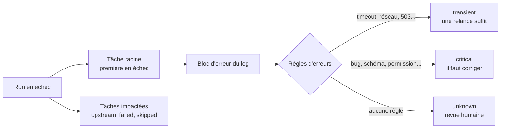
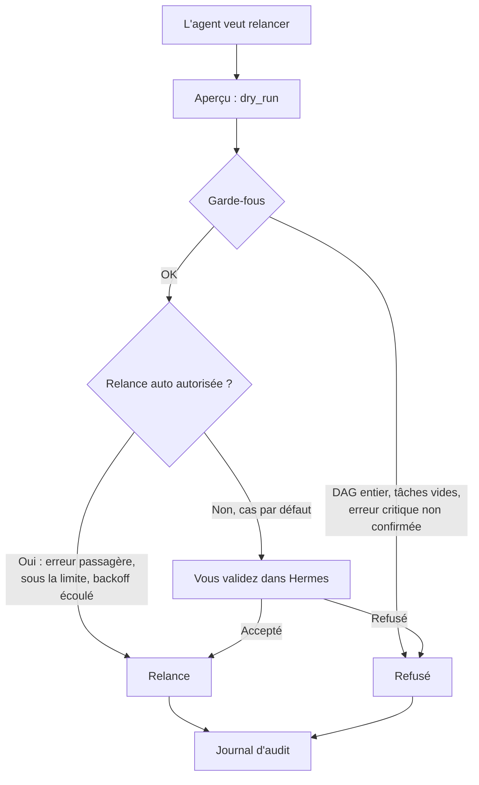
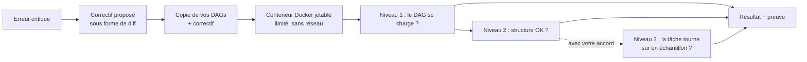

# Guide utilisateur — plugin `airflow-mlops`

Ce guide explique **ce que l'agent sait faire**, **les outils qu'il utilise** et **les réglages
que vous pouvez changer**, sans entrer dans le code. Pour les détails techniques, voir le
[README](../README.md).

> Version décrite : **0.5.0**.

---

## 1. En bref

Le plugin transforme l'agent Hermes en assistant pour **Apache Airflow**. Il sait faire cinq
choses :

| Fonction | En une phrase | Modifie Airflow ? |
|---|---|---|
| 🔍 **Surveiller** | Lister les DAGs, leurs runs, leurs tâches, leurs logs | Non |
| 🩺 **Diagnostiquer** | Trouver la tâche à l'origine d'une panne et dire si l'erreur est passagère ou grave | Non |
| 📊 **Rapporter** | Produire un rapport de santé, toujours dans le même format | Non |
| 🔁 **Relancer** | Relancer uniquement les tâches en échec, après votre accord | **Oui**, désactivé par défaut |
| 🧪 **Tester un correctif** | Essayer un correctif dans un conteneur Docker jetable avant de vous le proposer | Non, désactivé par défaut |

**Par défaut, le plugin est en lecture seule** : il ne peut rien modifier dans Airflow.

---

## 2. Démarrage rapide

1. **Installer et activer le plugin**
   ```bash
   hermes plugins install <owner>/<repo>
   hermes plugins enable airflow-mlops
   ```
2. **Donner les identifiants Airflow.** Hermes les demande à l'installation. Il en faut **un
   seul** des deux jeux suivants :
   - `AIRFLOW_USERNAME` + `AIRFLOW_PASSWORD`,
   - ou `AIRFLOW_TOKEN`.
3. **Indiquer où est Airflow**, dans `~/.hermes/config.yaml` :
   ```yaml
   plugins:
     entries:
       airflow-mlops:
         settings:
           base_url: https://airflow.mon-entreprise.com
           api_version: v2        # v2 = Airflow 3.x, v1 = Airflow 2.x
           auth_mode: jwt         # jwt (Airflow 3), basic (Airflow 2), token
   ```
4. Lancer `hermes chat` et demander : *« Quels DAGs sont en échec aujourd'hui ? »*

---

## 3. Ce que vous pouvez demander

Vous parlez normalement ; l'agent choisit les bons outils.

| Vous demandez… | L'agent utilise |
|---|---|
| « Liste mes DAGs ML » | `airflow_list_dags` |
| « Que fait le DAG `train_model` ? » | `airflow_get_dag` |
| « Les 10 derniers runs de `etl_daily` » | `airflow_get_dag_runs` |
| « Pourquoi le run d'hier a échoué ? » | `airflow_diagnose_run`, puis logs, XComs, dépendances |
| « Montre-moi le log de la tâche `load` » | `airflow_get_task_logs` |
| « Rapport de la semaine » ou `/airflow-report all 7d` | `airflow_build_report` |
| « Relance la tâche en échec » | `airflow_clear_tasks` : aperçu d'abord, puis votre accord |
| « Comment corriger cette erreur ? » | skill `airflow-fix-proposal`, qui propose un diff sans l'appliquer |
| « Vérifie que ton correctif marche » | `airflow_sandbox_test`, qui le teste dans le bac à sable |

**Commande rapide :** `/airflow-report [périmètre] [période]`

- périmètre : `all`, un nom de DAG, ou `tag:<étiquette>` ;
- période : `24h`, `7d`, `2w`, au maximum 90 jours.

Exemples : `/airflow-report`, `/airflow-report train_model 7d`, `/airflow-report tag:ml 24h`.

---

## 4. Les outils

### Lecture (sans risque)

| Outil | À quoi il sert | Paramètres principaux |
|---|---|---|
| `airflow_list_dags` | Liste des DAGs : en pause ou non, planification, étiquettes, prochain run | `tags`, `paused`, `limit` |
| `airflow_get_dag` | Détail d'un DAG : paramètres (secrets masqués), liste des tâches | `dag_id` |
| `airflow_get_dag_runs` | Derniers runs : état, durée | `dag_id`, `limit`, `state` |
| `airflow_get_run_status` | État de chaque tâche d'un run : essais, durée, attente | `dag_id`, `run_id` |
| `airflow_get_task_logs` | Fin du log d'une tâche et **bloc d'erreur extrait** | `dag_id`, `run_id`, `task_id`, `try_number` |
| `airflow_get_xcoms` | Données échangées entre tâches (masquées, tronquées) | `dag_id`, `run_id`, `task_id`, `key` |
| `airflow_get_dependencies` | Tâches en amont et en aval, avec leur règle de déclenchement | `dag_id`, `task_id`, `depth` |
| `airflow_diagnose_run` | **Diagnostic complet d'une panne en un appel** (voir § 5.1) | `dag_id`, `run_id` |
| `airflow_build_report` | **Rapport normé en 6 sections** (voir § 5.2) | `scope`, `period` |

### Écriture (protégée)

| Outil | À quoi il sert | Paramètres principaux |
|---|---|---|
| `airflow_clear_tasks` | Relancer certaines tâches d'un run (voir § 5.3) | `dag_id`, `run_id`, `task_ids`, `dry_run` (vrai par défaut), `reason` |

Cet outil est **invisible pour l'agent** tant que `read_only` vaut `true`.

### Bac à sable (ne modifie jamais Airflow)

| Outil | À quoi il sert | Paramètres principaux |
|---|---|---|
| `airflow_sandbox_test` | Tester un correctif (diff) dans un conteneur jetable (voir § 6) | `dag_id`, `patch`, `level`, `task_id` |

Cet outil est **invisible pour l'agent** tant que `sandbox_enabled` vaut `false`.

### Skills (méthodes de travail de l'agent)

| Skill | Rôle |
|---|---|
| `airflow-triage` | La méthode de diagnostic : trouver la cause racine, lire les preuves, relancer le minimum |
| `airflow-report` | La présentation du rapport : résumé, puis les 6 sections, sans chiffre inventé |
| `airflow-fix-proposal` | La proposition de correctif : cause, diff, **test en bac à sable**, risques, vérification. **Jamais appliquée par l'agent.** |

---

## 5. Comment ça marche

### 5.1 Le diagnostic



- Le plugin distingue **la cause** (la tâche racine) des **conséquences** (les tâches bloquées
  derrière).
- Chaque classification est **justifiée** : quelle règle a reconnu quelle ligne du log.
- Les règles sont dans [`data/error_patterns.yaml`](../data/error_patterns.yaml). Vous pouvez y
  ajouter vos propres erreurs métier (voir `error_patterns_path`, § 7).

### 5.2 Le rapport

Toujours les **mêmes 6 sections, dans le même ordre**, pour pouvoir comparer d'une semaine à
l'autre :

1. **Périmètre et période** : quels DAGs, quelle fenêtre de temps.
2. **Santé globale** : un **statut par DAG** (sain, dégradé, en échec), puis un statut global
   **expliqué** : il nomme les DAGs en cause et la raison. Un seul DAG en difficulté parmi
   plusieurs DAGs sains ne met pas tout en échec. On y trouve aussi le nombre de runs, le taux
   de succès et les incidents.
3. **Performance** : durée de chaque tâche comparée à sa durée habituelle, relances, attente,
   SLA.
4. **Qualité des données** : lue depuis un XCom `data_quality` publié par vos DAGs (voir le
   README). Sans cet XCom, la section affiche **« non instrumenté »** : jamais de chiffres
   inventés.
5. **Incidents et actions** : runs en échec et relances effectuées.
6. **Recommandations** : classées par gravité.

La « durée habituelle » (ligne de base) s'apprend toute seule, rapport après rapport.

### 5.3 La relance protégée



Les règles qu'**aucun réglage ne peut désactiver** :

- jamais une tâche déjà réussie, ni le DAG entier : seules la tâche en échec et les tâches
  qu'elle a bloquées sont relancées ;
- toujours un aperçu d'abord ;
- jamais en dehors de l'allowlist ;
- pas de relance d'une erreur grave sans confirmation explicite ;
- une raison obligatoire ;
- **pas de relance si le journal ne peut pas l'enregistrer**.

### 5.4 Le journal d'audit

Chaque tentative est notée : aperçu, refus, relance ou erreur. Le journal enregistre **qui**
(session Hermes), **quoi** (DAG, run, tâches), **quand** et **pourquoi** (la raison donnée). Il
apparaît dans la section 5 du rapport.

---

## 6. Le bac à sable

**But :** avant de vous proposer un correctif, l'agent le **teste sur une maquette** dans un
conteneur Docker jetable. Il vous présente ensuite une solution **qui a déjà fonctionné**, avec
la preuve. Il n'applique toujours rien en production.



### Les trois niveaux

| Niveau | Ce qui est vérifié | Coût | Votre accord ? |
|---|---|---|---|
| `import` | Le DAG corrigé se charge sans erreur | quelques secondes | non |
| `structure` | Les tâches et dépendances, comparées à la production | quelques secondes | non |
| `task` | **Une seule tâche** tourne, sur un **petit échantillon** | limité | **oui**, toujours demandé (par défaut) |

Le niveau au-delà duquel votre accord est demandé se règle avec `sandbox_max_level`. La valeur
par défaut est `structure`.

### Pourquoi il ne peut pas lancer une tâche trop lourde

- **Conteneur bridé** : 1 CPU, 2 Go de mémoire sans swap, 256 processus, 5 minutes au maximum.
  Tout est réglable. Au-delà, le conteneur est tué et le résultat indique « mémoire » ou
  « temps » dépassé.
- **Aucun réseau** (`--network none`) et **aucun identifiant** : impossible de joindre la
  production, l'entrepôt de données ou un cluster. Une tâche qui essaierait échoue tout de suite.
- **Système de fichiers en lecture seule**, sauf un `/tmp` limité à 512 Mo.
- **Opérateurs lourds jamais exécutés** : Spark, Kubernetes, Snowflake, BigQuery, Bash, Docker,
  SSH… restent aux niveaux `import` et `structure`. La liste est réglable.
- **Un seul test à la fois**, et au maximum 5 par session Hermes. C'est réglable.
- **Votre code n'est jamais modifié** : le test travaille sur une copie, supprimée juste après.
- **Chaque test est journalisé** et apparaît dans le rapport (section 5).

### Pour que la tâche travaille sur un échantillon (niveau `task`)

Le conteneur fournit trois variables d'environnement à vos tâches :

| Variable | Valeur | Usage conseillé dans votre DAG |
|---|---|---|
| `AIRFLOW_SANDBOX` | `1` | « je suis en test » : ne rien écrire hors de `/tmp` |
| `AIRFLOW_SANDBOX_SAMPLE_ROWS` | `1000` (réglable) | limiter le volume lu, ex. `LIMIT 1000` ou `df.head(n)` |
| `AIRFLOW_SANDBOX_FIXTURES` | chemin d'un fichier JSON | les XComs d'entrée du run en échec (masqués), à utiliser à la place de `xcom_pull` |

Exemple :
```python
import os

rows = int(os.environ.get("AIRFLOW_SANDBOX_SAMPLE_ROWS", 0)) or None
df = read_table(limit=rows)  # lit tout en production, 1000 lignes en test
```

### Mise en place (une seule fois)

1. **Docker** doit tourner sur la machine de Hermes, et le terminal de Hermes doit être local
   (cas par défaut).
2. **Construire une image** avec Airflow et les dépendances de vos DAGs. Le conteneur de test
   n'a pas de réseau et ne peut donc pas faire de `pip install` :
   ```dockerfile
   FROM apache/airflow:3.1.0          # même version que votre production
   COPY requirements.txt /tmp/requirements.txt
   RUN pip install --no-cache-dir -r /tmp/requirements.txt
   ```
   ```bash
   docker build -t mon-airflow-sandbox:1 .
   ```
3. **Activer** dans `config.yaml` :
   ```yaml
   sandbox_enabled: true
   sandbox_image: mon-airflow-sandbox:1
   sandbox_dags_path: C:/chemin/vers/mes/dags     # copié à chaque test, jamais modifié
   ```

## 7. Les réglages modifiables

Ils se placent dans `~/.hermes/config.yaml`, sous
`plugins.entries.airflow-mlops.settings`. Seuls les identifiants (§ 2) sont des secrets ; tout le
reste se règle ici.

### Connexion à Airflow

| Réglage | Défaut | À changer quand… |
|---|---|---|
| `base_url` | `http://localhost:8080` | toujours : l'adresse de votre Airflow |
| `api_version` | `v2` | vous êtes sur Airflow 2.x → `v1` |
| `auth_mode` | `jwt` | Airflow 2 avec login → `basic` ; jeton fixe → `token` |
| `verify_tls` | `true` | certificat interne non reconnu (déconseillé de le désactiver) |
| `timeout_seconds` | `15` | votre Airflow répond lentement |
| `max_retries` | `2` | réseau instable (lectures uniquement) |
| `page_size` | `100` | rarement |

### Périmètre et sécurité

| Réglage | Défaut | À changer quand… |
|---|---|---|
| `dag_allowlist` | `["*"]` (tous) | vous voulez limiter l'agent à certains DAGs, ex. `["ml_*", "etl_daily"]` |
| `read_only` | `true` | vous voulez autoriser les relances → `false` |

### Taille des réponses (pour ne pas noyer l'agent)

| Réglage | Défaut | À changer quand… |
|---|---|---|
| `log_max_lines` | `200` | vous voulez plus ou moins de log |
| `log_max_chars` | `20000` | idem, en caractères |
| `error_context_lines` | `40` | les tracebacks sont très longs |
| `xcom_max_chars` | `2000` | vos XComs sont volumineux |

### Diagnostic

| Réglage | Défaut | À changer quand… |
|---|---|---|
| `error_patterns_path` | vide (règles livrées) | vous avez votre propre fichier de règles d'erreurs |

### Rapports

| Réglage | Défaut | À changer quand… |
|---|---|---|
| `report_default_period` | `24h` | vous préférez un rapport hebdomadaire → `7d` |
| `data_quality_xcom_key` | `data_quality` | vos tâches qualité utilisent une autre clé XCom |
| `sla_thresholds` | `{}` (aucun) | vous voulez suivre des SLA, ex. `{"etl_daily": 3600, "etl_daily.load": 600}` (en secondes) |

### Relance automatique

Ces réglages n'ont d'effet que si `read_only: false`.

| Réglage | Défaut | À changer quand… |
|---|---|---|
| `auto_remediation_enabled` | `false` | vous acceptez que les erreurs **passagères** soient relancées sans vous demander |
| `auto_retry_max_attempts` | `2` | nombre de relances automatiques par tâche avant de vous demander |
| `auto_retry_backoff_seconds` | `300` | délai minimal entre deux relances automatiques (doublé à chaque fois) |

### Bac à sable

| Réglage | Défaut | À changer quand… |
|---|---|---|
| `sandbox_enabled` | `false` | vous voulez que l'agent teste ses correctifs → `true` |
| `sandbox_image` | vide | toujours, si activé : votre image Airflow + dépendances |
| `sandbox_dags_path` | vide | toujours, si activé : le dossier local de vos DAGs |
| `sandbox_max_level` | `structure` | `import` pour encore moins d'exécution ; `task` pour ne plus être sollicité au niveau 3 (déconseillé) |
| `sandbox_cpus` | `1` | vos tâches ont besoin de plus (maximum 8) |
| `sandbox_memory` | `2g` | de `256m` à `16g` |
| `sandbox_timeout_seconds` | `300` | de 30 à 540 secondes |
| `sandbox_sample_rows` | `1000` | taille de l'échantillon proposé à vos tâches |
| `sandbox_heavy_operators` | Spark, Kubernetes, Databricks, Snowflake, BigQuery, EMR, Bash, Docker, SSH | ajouter vos propres opérateurs lourds |
| `sandbox_max_tests_per_session` | `5` | budget de tests par session Hermes |

---

## 8. Sécurité en 6 points

1. **Secrets masqués** : mots de passe, tokens et chaînes de connexion sont remplacés par
   `[REDACTED]` avant d'être montrés à l'agent.
2. **Allowlist** : un DAG hors liste est refusé avant tout appel à Airflow.
3. **Lecture seule par défaut.**
4. **Validation humaine** pour toute relance, sauf la relance automatique bornée si vous
   l'activez.
5. **Journal** de toutes les actions.
6. **Aucune donnée écrite dans le dossier du plugin** : tout est dans la base SQLite privée du
   plugin, gérée par Hermes.

---

## 9. Que veulent dire les erreurs ?

| Type d'erreur | Signification | Que faire |
|---|---|---|
| `config` | identifiants manquants pour le mode d'authentification choisi | vérifier `auth_mode` et les secrets |
| `auth` / `forbidden` | Airflow refuse l'accès (401 / 403) | vérifier l'utilisateur et ses droits |
| `network` / `timeout` | Airflow injoignable ou lent | vérifier `base_url`, le VPN, `timeout_seconds` |
| `not_found` | DAG, run ou tâche inexistant | vérifier l'identifiant |
| `dag_not_allowed` | DAG hors `dag_allowlist` | l'ajouter à la liste si c'est voulu |
| `guardrail` | une règle de sécurité a refusé la relance | lire le message : il explique quoi faire |
| `sandbox` | le bac à sable a refusé ou n'a pas pu préparer le test (désactivé, budget, opérateur lourd, diff qui ne s'applique pas) | lire le message |
| `invalid_argument` | paramètre mal formé | reformuler la demande |
